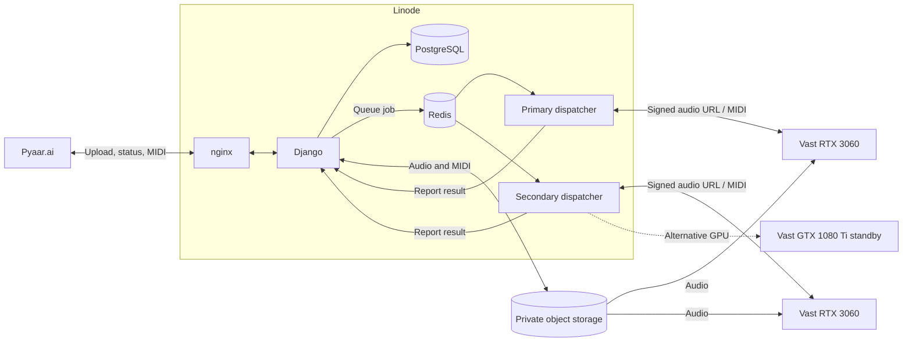

# whats-the-tab

Turn music recordings into MIDI. Upload an audio file, wait for transcription,
then preview or download the MIDI. [Try it on Pyaar.ai](https://pyaar.ai).

## How it works

Django checks that an upload contains readable audio and queues transcription
in Redis. A GPU runs MT3 inference while the browser polls for the result.



## Run locally

For local inference, install Docker Compose and configure Docker with the
[NVIDIA Container Toolkit](https://docs.nvidia.com/datacenter/cloud-native/container-toolkit/latest/install-guide.html).

```bash
docker compose --profile gpu up --build
```

The API is available at `http://127.0.0.1:8008`. To run only Django,
PostgreSQL, and Redis, use `docker compose up --build web`. See the
[local Compose guide](docs/local-compose.md) for the smoke test and test suite.

## Use the API

```bash
base=http://127.0.0.1:8008/transcribe
curl -F 'audio=@song.mp3' "$base/upload/"
```

Set `id` to the returned `audio_midi_id`, then queue the job and check its status.

```bash
id=123
curl -d "audio_midi_id=$id" "$base/generate/"
curl "$base/status/$id/"
```

Once the status is `completed`, download the MIDI.

```bash
curl -fL "$base/download_midi/$id/" -o song.midi
```

## Deployment

- [Linode cutover and rollback](docs/handoff-linode-cutover.md)
- [Vast Serverless GPU setup](docs/vast-serverless.md)
- [Private object storage](docs/object-storage.md)
- [Configuration options](.env.example)

The transcription model is a PyTorch reimplementation of
[Google Magenta's MT3](https://github.com/magenta/mt3). For research, cite the
[original MT3 paper](https://openreview.net/forum?id=iMSjopcOn0p).

[Apache License 2.0](LICENSE)
