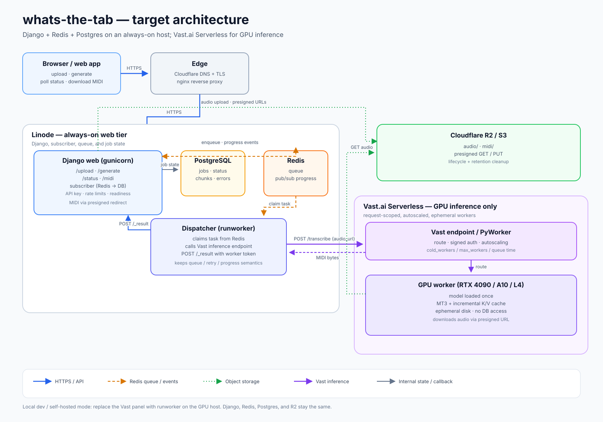
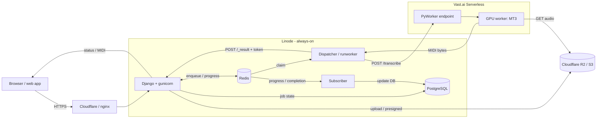
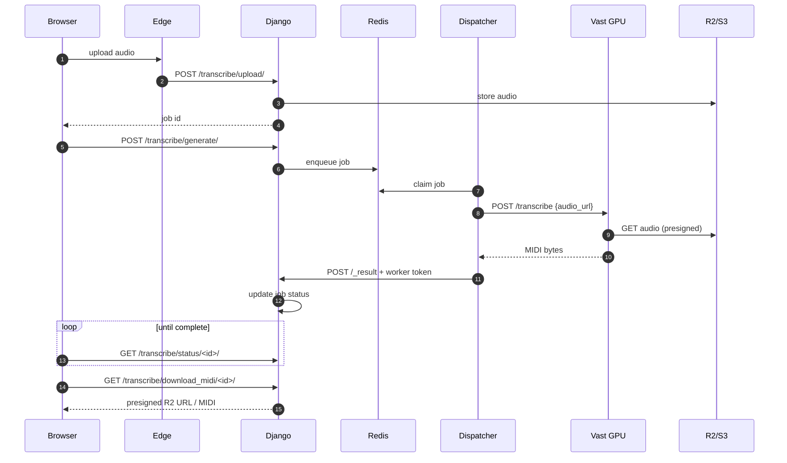

# Architecture



The target deployment keeps the stateful, always-on pieces on a small web host
and uses Vast.ai Serverless only for GPU inference.

- **Web tier:** Django + gunicorn, the Redis subscriber, Redis, and PostgreSQL.
- **Object storage:** Cloudflare R2 or S3 for uploaded audio and generated MIDI.
- **GPU tier:** a Vast serverless endpoint running the MT3 model server and
  PyWorker. Workers are ephemeral and have no database or Redis access.
- **Dispatcher:** the existing `runworker` process claims Redis jobs and calls
  the Vast endpoint. It keeps the current retry, progress, and result-callback
  behavior.

## Request lifecycle

1. The browser uploads audio through the edge proxy to Django.
2. Django stores the audio in R2/S3 and creates an `AudioMIDI` row in Postgres.
3. `POST /generate/` enqueues a task in Redis.
4. The dispatcher claims the task.
5. The dispatcher sends a presigned audio URL to the Vast inference endpoint.
6. The Vast GPU worker downloads the audio from R2/S3 and runs MT3.
7. The GPU worker returns MIDI bytes to the dispatcher.
8. The dispatcher posts the result to Django with `X-Worker-Token`.
9. Django updates Postgres and the Redis subscriber publishes progress updates.
10. The browser polls `/status/` and downloads the MIDI through Django, which
    redirects to a presigned R2/S3 URL.

## Mermaid overview



## Sequence



## Local / self-hosted mode

Replace the Vast panel with `runworker` running on the GPU host. Django, Redis,
Postgres, and R2 stay the same. This is the current Docker Compose setup when
using:

```bash
docker compose --profile gpu up --build
```

## Notes

- For the implementation handoff and remaining Vast work, see
  [`handoff-vast-serverless.md`](handoff-vast-serverless.md).
- The Vast worker image is built from `Dockerfile` and includes the converted
  MT3 checkpoint.
- The old pre-converted checkpoint release is gone; `prepare_checkpoint.py`
  downloads the public T5X checkpoint and converts it during the image build.
- Vast workers never receive database credentials. All state changes go through
  the dispatcher's authenticated result callback.
