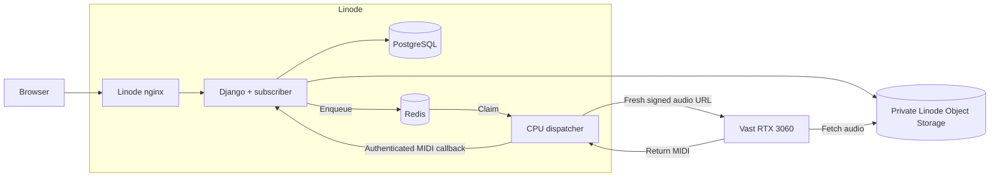

# Handoff for the Linode cutover

## Objective and next step

Restore public audio-to-MIDI transcription through Linode and Vast. Cut over
after a private upload produces a playable, downloadable MIDI and a valid
job succeeds after a corrupt upload. Verify the public path and keep the
nginx rollback ready.

The private Linode stack is healthy. An earlier idle RTX 3060 was unreachable.
On November 21, the dispatcher connected to a replacement RTX 3060 at the
address supplied by Vast, and the inference probe returned HTTP 200.
Both private audio uploads completed and produced playable, downloadable MIDI.
Public HTTPS transcription is live. The corrupt-upload recovery test passed.
Recovery from a lost GPU worker remains unverified.

Keep credentials and presigned URLs out of Git and public test evidence.

## Operating target

Expect up to 10 asynchronous jobs per day. First prove private end-to-end
transcription with a short melody and a representative song. Keep at least
two verified GPU workers active. Leave a worker running after it passes a
transcription test. Clean up disposable jobs and media independently.



## Starting point

| Item | Last verified state |
| --- | --- |
| Code | Vast dispatch and the GPU comparison are on `origin/main` through `147c33f` |
| Local Compose | 27 tests passed. Local RTX 4090 completed three recordings and recovered after a corrupt upload |
| Vast staging | Isolated desktop staging used the real private Linode bucket, Vast, and the authenticated Django result callback |
| RTX 3060 | Deployment `whats-the-tab-3060`, ID `5789`, endpoint ID `45265`, endpoint name `deployment-whats-the-tab-3060-default` |
| RTX 4090 comparison | Deployment `whats-the-tab`, ID `5788`, endpoint ID `45264` |
| GPU image | Public pull by digest was verified for `ghcr.io/osamja/whats-the-tab-worker@sha256:890de0cb5e7c477ccb7397afd8556af86a7914c4f19c63ff76dac68e823ce49a` |
| Vast worker state | Both deployments were stopped after the tests and both rented instances exited |
| Linode Object Storage | A temporary object returned HTTP 403 unsigned and HTTP 200 with a signed GET. The probe object was removed |
| Public routing | Last inspection found `pyaar.ai` transcription locations pointing to `vast-ai-backend`. The cutover had not started |

The two GPUs returned byte-identical MIDI for both files. The 3060 produced
four notes for the melody and 730 notes for the 71-second piano recording.
Its end-to-end cold melody took 392.68 seconds and its warm piano took
37.38 seconds. The 4090 took 438.28 seconds and 17.24 seconds respectively.
The selected 3060 host was about $0.070/hr versus $0.486/hr for the 4090.
The estimated warm job cost was 69% lower on the 3060, excluding idle time.
See the [Vast runbook](vast-serverless.md) for the full comparison.

## 1. Inventory and prepare Linode

- Use the existing SSH connection helper on the owner's desktop
  (`~/Work/linode.sh`) or the SSH session already on Linode. Last inspection saw
  the proxy Compose project under `~/workspace/nginx_sammyjaved_proxy`, with
  a `my-site-proxy` nginx service and a `prod_network`. Recheck names, ports,
  mounted config, and the active upstream using `docker compose ls`,
  `docker ps`, `ss -lnt`, and `nginx -T` inside the proxy container. Filter
  or redact config output before sharing it.
- Use a real Git checkout at a recorded revision. The directory named
  `~/workspace/whats-the-tab` existed during the prior inspection and did
  not have Git metadata. Inspect its contents before reusing it and choose
  a new directory if needed.
- Determine where the legacy service stores uploads, MIDI, job records, and
  queued work. If existing links or jobs must survive, agree on a migration
  or a way to route legacy job IDs before switching traffic. A fresh database
  can reuse old numeric IDs. Keep database and queue credentials independent
  of other apps on the host. Back up any production state being changed.
- Confirm the production browser's actual URL and payload contract, including
  upload size, CORS, auth, download URLs, and whether it uses YouTube or
  legacy `/transcribe/download/` and `/transcribe/download_wav/` routes.
  The current backend offers `/transcribe/download_midi/<id>/` and
  `/transcribe/midi/<id>/`. Resolve client compatibility before cutover.
- The verified Vast key lives in the owner's desktop `.env`. Arrange a
  secure transfer or provision a dispatcher key on Linode. Restrict secret
  file permissions to the service account. Avoid printing `.env`,
  `docker compose config` with secrets expanded, or a signed URL.
- Agree on the acceptable first-request latency. Zero standby workers kept
  the staging configuration small, but both observed cold starts exceeded
  six minutes. Keep the 600-second dispatcher deadline and the observed cold
  timing in view when choosing a production standby and timeout policy.

## 2. Bring up a private Linode origin

Use Compose with a Linode-specific override. The checked-in Compose file is
the development baseline. Before starting it on Linode, configure the following.

- Run a dedicated PostgreSQL, Redis, and Django stack with persistent volumes.
  Remove the development host publishes for PostgreSQL and Redis. A
  loopback Redis listener already occupied port 6379 during the prior
  inspection. Use a non-default database password and a matching
  `DATABASE_URL`. Keep Django private to the Compose networks or bind it to
  a free loopback port for staging. Attach nginx to a shared network and use
  a unique DNS alias when ready for cutover. Use the nginx container's
  view of the network to verify reachability.
- Run `web` with a strong `SECRET_KEY`, a separate `WORKER_SHARED_SECRET`,
  `DEBUG=False`, and `SERVE_MEDIA=False`. Wire the production host and
  origin settings into the container explicitly. nginx supplies the public
  HTTPS redirect and forwards the original `Host` and
  `X-Forwarded-Proto`. If enabling Django's HTTPS redirect, account for it
  in both the internal HTTP callback and the Compose readiness probe before
  deploying. Enable secure cookies for the public HTTPS origin as applicable.
  Confirm that any `TRANSCRIBE_API_KEY` policy agrees with the clients.
- Configure the private bucket using [object-storage.md](object-storage.md).
  Give web and dispatcher the same bucket, region, endpoint, and addressing
  style. For Linode retain the `when_required` checksum settings.
  Check the exact signed GET hostname against the worker's `VAST_AUDIO_HOST`.
  Ensure the signed URL lifetime exceeds the dispatcher request deadline.
- Add a supervised CPU dispatcher service running `python manage.py runworker`
  with the pinned optional SDK in [requirements.txt](../deploy/vast/requirements.txt).
  Build it from the web runtime or equivalent Python 3.11 environment with
  the same checkout. Include ffmpeg if supporting YouTube downloads. Start
  it after Django is healthy. Compose web already starts the subscriber.
  The local `gpu` profile is for executing MT3 on the Docker host.
- The dispatcher shares `DATABASE_URL`, `REDIS_URL`, storage credentials,
  and `WORKER_SHARED_SECRET` with web. Set `WEB_URL=http://web:8008` when both
  services use the same Compose network. Set the verified Vast endpoint
  name as `VAST_ENDPOINT_NAME`. Pass `VAST_API_KEY` only to the dispatcher
  and the provisioning environment. The Vast GPU receives a presigned URL
  and carries no storage, PostgreSQL, Redis, or Django credentials.
- Check Compose syntax with `docker compose config --quiet`. Start the
  services with the actual override enabled and use `docker compose ps` and
  `/transcribe/ready/` to confirm PostgreSQL and Redis are reachable and
  the dispatcher is heartbeating. Use a disposable Redis for the Django
  test suite because queue tests clear the configured test Redis database.

## 3. Activate the 3060 and validate the Linode path

1. Inspect deployment `5789`. Verify the image digest, GPU, one-worker
   cap, and signed audio host. Start the existing deployment in Vast. If
   recreating it, follow the [Vast runbook](vast-serverless.md) and explicitly
   set `VAST_DEPLOYMENT_NAME=whats-the-tab-3060` and `VAST_GPU_NAME="RTX 3060"`.
   Read back the resulting endpoint name before configuring the dispatcher.
2. Test the private Linode origin from the host or via an SSH tunnel using a
   disposable, cleared-for-testing audio file. Use an upload of a four-second
   melody when available, then a representative song on the same worker.

   ```bash
   uv run python scripts/smoke_compose.py \
     --url http://127.0.0.1:18009/transcribe --timeout 650 \
     /path/to/test-melody.wav /tmp/linode-melody.midi
   ```

   Substitute the actual private origin. The smoke script assumes the
   public-facing test endpoints accept requests without a client API key.
   Where a client key is required, exercise the same requests with approved
   client credentials or use a private staging instance. The callback still
   needs to reject requests without the worker token.
3. Confirm the job moves from queued to processing to completed, with a
   downloadable, parseable MIDI containing notes. Verify data lands in the
   intended database and private bucket, unsigned retrieval fails, and the
   dispatcher succeeds via its internal callback. Record cold and warm
   enqueue-to-download times, any limit hit, and the selected hourly rate.
4. Run a malformed audio test and then a valid request to confirm recovery.
   If required for the client, test YouTube upload and the subsequent
   transcription separately. Clean up disposable test jobs and media using
   their recorded IDs. Keep the old nginx route active through this phase.

## 4. Cut over and verify rollback

1. Capture the exact active nginx route config and upstream membership.
   In the source Compose/proxy checkout, prepare the minimal transcription
   route change to the verified Linode service alias. Preserve the
   frontend's paths, trailing slashes, request limits, headers, TLS, and
   routing for other applications. Keep the internal result callback on
   the private network where practical.
2. Verify service name resolution and HTTP readiness from inside nginx.
   Validate the candidate configuration with `nginx -t`. Apply it through
   the project's normal reload/redeploy process after the timing and
   legacy-job handling are agreed.
3. Run a public HTTPS smoke test and test the actual frontend. Confirm upload,
   status, MIDI download, CORS/auth, and error behavior. Watch nginx, Django,
   dispatcher, and Vast logs for route errors, repeated timeouts, or failures.
   Spot-check adjacent services on the same proxy.
4. If the public path fails or latency exceeds the agreed threshold, restore
   the prior nginx config, validate, reload, and verify the old route. Keep the
   new database, bucket objects, and queued jobs available for reconciliation.
   Avoid treating new job IDs as legacy IDs. Keep verified GPU capacity
   active during routing rollback so it remains available for reconciliation.

Done means the public client completes a real HTTPS upload-to-MIDI request
through Linode and Vast, the result stays in private storage, the measured
latency is acceptable, and the operator can restore the old route. Record
the deployed commit, image digest, endpoint, Compose and nginx config
locations, smoke test outcomes, and rollback command in the handoff notes.

## Linode Compose configuration

Run these commands from the checkout on Linode. Use Compose v2.24.4 or
newer for the port overrides. Keep the environment file outside the
checkout and readable only by the deployment account.

Set `SECRET_KEY`, `WORKER_SHARED_SECRET`, and `LINODE_DB_PASSWORD` to
independent random values. Use a URL-safe database password, such as
`openssl rand -hex 32`. Supply `VAST_API_KEY` and the five required
`AWS_*` variables from the private bucket configuration. The override
uses two dispatchers and stages Django on
`127.0.0.1:18009`. Set `LINODE_WEB_PORT` if that port is in use.
The frontend checkout sends requests without a client API key. Leave
`TRANSCRIBE_API_KEY` empty unless the frontend is updated to supply one.

```bash
compose=(docker compose -p whatsthetab-linode --env-file "$LINODE_ENV_FILE"
  -f docker-compose.yml -f docker-compose.linode.yml)
"${compose[@]}" config --quiet
"${compose[@]}" up --build -d --wait
"${compose[@]}" ps
curl --fail --silent http://127.0.0.1:18009/transcribe/ready/
```

Wait for `workers_online` to reach 1 before submitting the smoke job.
PostgreSQL and Redis stay on the project network. For nginx verification,
attach only web to the proxy network using a unique alias after the private
smoke test. Keep the attachment in the deployed Compose configuration so
it survives container replacement.

### Linode operator record

- Compose project `whatsthetab-linode` uses `docker-compose.yml` and
  `docker-compose.linode.yml` from `~/workspace/whats-the-tab`. The transferred
  credentials are in the ignored, mode-0600 `.env`. Pass that file first with
  `--env-file .env`, then pass
  `--env-file ~/.config/whatsthetab-linode/database.env` for the independently
  generated database password.
- The deployed source revision for the private origin is `0ee3c1261bbb`.
  Web and dispatcher images built on Linode. The isolated PostgreSQL and
  Redis rehearsal passed all 28 Django tests. Private readiness reported
  one dispatcher. An unsigned audio object GET returned 403 and a signed
  GET returned 200. The private result endpoint returned 403 without the
  worker token. The `www.pyaar.ai` origin received an explicit CORS header
  from Django. A synthetic MIDI fixture from the private bucket confirmed
  the same-origin preview returns 200 and the signed download redirect
  returns 302. The unsigned MIDI GET returned 403.
- Vast deployment `5789` uses endpoint `45265`,
  `deployment-whats-the-tab-3060-default`, with a one-worker cap and the
  digest recorded above. The listed stopped RTX 3060 rental was
  about $0.06989/hr. The first Linode melody moved to queued and processing
  before failing at 600.89 seconds. Vast reported zero ready workers and
  said the previous worker's host lacked resources when asked to restart it.
  A rolling update and stop/start did not provide a ready replacement.
  The second private melody timed out after 600.85 seconds.
- The separately tagged Vast deployment `5792` used endpoint `45268`,
  `deployment-whats-the-tab-3060-linode`, the same image and GPU, and a
  one-worker cap. It rented an RTX 3060 at $0.107/hr. The worker logs
  showed retries on layer `8ac6d7d2262f`, which is 6.15 GiB compressed,
  while the worker remained in loading. Its cold melody timed out after
  600.52 seconds. The layer later downloaded. A retry on the same rental
  timed out after 600.45 seconds while Vast's runtime wrapper was still
  installing Ubuntu packages. No Linode job produced a GPU-generated
  MIDI, so warm timing and malformed-audio recovery could not be measured.
- Both Vast deployments reported stopped. Rental `61382539` exited.
  Vast accepted the stop for `61393059` and reported its desired and
  current state as stopped, but the worker's actual status was still
  loading on the last check. Its exit remained unconfirmed.
- The disposable job rows and bucket objects were removed. The dispatcher
  was restored to its original endpoint configuration. Public routing
  still points to the legacy upstream. Cutover requires a successful
  private transcription, a latency decision, and a legacy-job plan.
- The active nginx config is
  `~/workspace/nginx_sammyjaved_proxy/nginx.conf`, mounted at
  `/etc/nginx/nginx.conf` in `nginx_sammyjaved_proxy-my-site-proxy-1`.
  The private snapshot is
  `~/.config/whatsthetab-linode/nginx-before-cutover.conf`.
  The active config passed `nginx -t`. Before cutover,
  `https://pyaar.ai/transcribe/` returned 502 on the legacy upstream and the
  Pyaar and adjacent homepages returned 200.

After a future nginx change, restore the captured config using the same
bind-mounted file, then validate and reload:

```bash
proxy="$HOME/workspace/nginx_sammyjaved_proxy/nginx.conf"
snapshot="$HOME/.config/whatsthetab-linode/nginx-before-cutover.conf"
test -s "$snapshot" && cat "$snapshot" > "$proxy" &&
  docker exec nginx_sammyjaved_proxy-my-site-proxy-1 nginx -t &&
  docker exec nginx_sammyjaved_proxy-my-site-proxy-1 nginx -s reload
```

### Prewarmed worker retry

The tagged deployment `5792` reached Vast's `idle` worker state before
the staging deadline. The Linode dispatcher submitted a private melody job
only after that readiness signal. Vast assigned a worker, but the SDK
repeatedly returned `ClientConnectorError` on the direct worker connection.
The job failed after 24.92 seconds. The dispatcher was restored to its
original endpoint configuration, the tagged deployment was stopped, rental
`61393059` exited, and the test job and private audio were removed.

The next test needs to verify that Linode can connect to the worker address
and port returned by Vast routing while that worker is idle. Then run the
private audio-to-MIDI smoke suite before changing public nginx routing.

On 2026-11-20, Vast assigned replacement rental `61585795`. Its host went
offline, then resumed startup and retried image downloads after an unexpected
EOF. It never became ready within 20 minutes, so the socket probe could not
run. Deployment `5792` was stopped. Vast marked the rental stopped, but its
last actual status was still loading. Private readiness passed and the public
legacy upstream still returned HTTP 502.

### Private transcription proof on 2026-11-21

RTX 3060 deployment `5792` and endpoint `45268` passed the exact-route TCP
probe and inference request. The prewarmed rental was about $0.079/hour.

| Private upload | MIDI notes | Enqueue to verified MIDI |
| --- | ---: | ---: |
| Four-second melody | 4 | 3.55 s |
| 70-second rendered piano fixture | 338 | 25.93 s |

Both previews matched the signed downloads, and unsigned MIDI requests
returned 403. The disposable jobs and their private objects were removed.
The RTX 3060 and RTX 4090 comparison deployments were stopped. The 3060
exited, while the 4090 still reported loading with a requested stop at
the last check. The dispatcher returned to its original configuration.
Public transcription still returned 502 through the legacy upstream.

### Two warm workers on 2026-11-21

Linode runs two dispatchers on the same private Redis queue. The primary uses
`deployment-whats-the-tab-3060-linode-b` (endpoint `45585`). The secondary
uses `deployment-whats-the-tab-3060-linode` (endpoint `45268`). Each endpoint
has `min_load=1`. Use `VAST_ENDPOINT_NAME` and
`VAST_SECONDARY_ENDPOINT_NAME` to change the dispatcher endpoints.

RTX 3060 rentals `61769935` and `61770053` ran on separate hosts. Each
dispatcher claimed one of two simultaneous private melody jobs. Both
returned four-note MIDI files in about 3.4 seconds from enqueue to verified
download. The jobs and private objects were removed. Both workers were left
running. Public routing was unchanged.

GTX 1080 Ti endpoint `45586` also passed a private melody upload. Its
temporary dispatcher claimed job `13` and returned a four-note MIDI in
3.89 seconds. The GPU was left running as a verified standby. The two
RTX 3060 dispatchers remain the default queue consumers.

### Public cutover on 2026-11-21

Proxy commit `0515965` routes new transcription traffic to
`whatsthetab-linode-origin:8008` on the shared Docker network. The Compose
override declares the alias for future container replacement. Linode job IDs
start at `1000000000000`. The proxy sends IDs of up to 12 digits and the old
download routes to the legacy upstream, which still returns 502. Legacy data
was not migrated. The worker result callback is private.

A corrupt private upload failed and the next valid upload returned MIDI.
A public HTTPS smoke job completed in 3.66 seconds. Headless Chromium loaded
`www.pyaar.ai`, uploaded an MP3 through the actual frontend, and downloaded
the same MIDI bytes as the preview. Both Pyaar homepages and the adjacent
`sammyjaved.com` homepage returned 200. Test jobs and objects were removed.
Both serving RTX 3060 workers stayed running. Use the captured proxy config
and rollback commands above if the public route needs to be restored.
