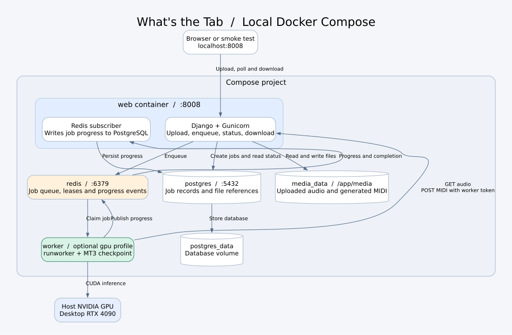
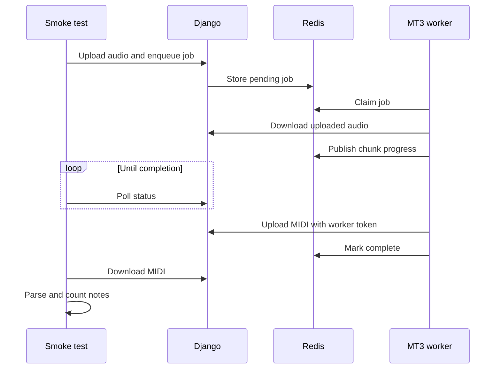

# Local Compose validation



## Run the checks

Use an NVIDIA driver and a Docker installation configured for NVIDIA containers
when running the `gpu` profile. The example starts the stack with filesystem
storage and development settings. Run it against your development stack or use
a separate Compose project with unique container names and published ports.
Compose starts the worker after Django reports a healthy database and Redis.

```bash
AWS_STORAGE_BUCKET_NAME= SERVE_MEDIA=True \
  docker compose --env-file /dev/null --profile gpu up --build -d

docker compose --env-file /dev/null exec -T \
  -e TEST_REDIS_URL=redis://redis:6379/15 \
  -e SERVE_MEDIA=False web python manage.py test

uv run python scripts/smoke_compose.py /path/to/audio.ogg /tmp/transcription.midi
```

Use a disposable Redis instance for the test suite. The queue tests clear
database 15. The smoke test checks readiness, verifies that the result callback
rejects a request without a worker token, then uploads and queues audio. It
waits for completion and writes the downloaded MIDI after parsing it and
confirming it contains notes.



For a repeatable real-audio check, use the piano and orchestral samples from
[librosa's example recordings](https://librosa.org/doc/main/recordings.html).
A parsed MIDI file with notes verifies the pipeline. Measuring pitch and timing
accuracy requires a reference transcription.

## Desktop RTX 4090 results

The isolated Compose stack passed all 27 Django tests against PostgreSQL and
Redis. The GPU worker processed these uploads through Django and returned
MIDI through the authenticated callback.

| Recording | Audio | Notes | Enqueue to MIDI download |
| --- | ---: | ---: | ---: |
| Generated melody | 4.00 s | 4 | 4.54 s |
| Pistachio Ice Cream Ragtime | 70.77 s | 730 | 8.05 s |
| Hungarian Dance No. 5 | 45.84 s | 808 | 10.57 s |

A corrupt audio upload reached `failed` without a MIDI result. The next
melody job completed successfully. This desktop used a temporary Compose
override for the NVIDIA devices and read-only host driver libraries because
Docker's standard GPU reservation could not discover an NVIDIA runtime.

The Brahms MIDI ended at 38.28 seconds. Testing the last ten seconds as a
separate clip recovered notes through 39.94 seconds of the original recording,
which still had signal through about 43.4 seconds. The missing tail also
occurred outside the Compose pipeline. Measuring the loss against ground truth
is still pending.
